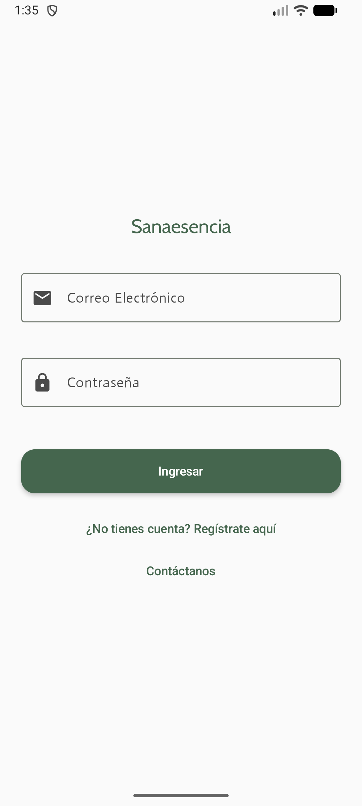
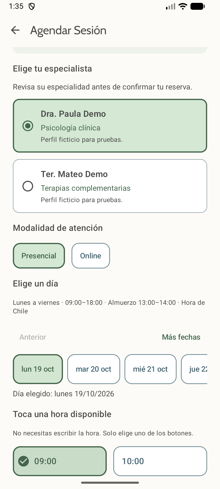

# Sanaesencia

Aplicación Android de demostración para consultar servicios, reservar sesiones y orientar la llegada al Centro Integrativo Sanaesencia de Los Vilos. Desarrollada como proyecto académico de **DSY1105 — Desarrollo de Aplicaciones Móviles**, Evaluación Parcial 2.

## Integrantes

**Grupo 4**

- Felipe Andres Araya Henriquez
- Antonia Sofia Munoz Pizarro

## Objetivo

Facilitar la reserva de una sesión mediante un flujo guiado: elegir servicio, especialista, modalidad, día y una hora disponible. La aplicación incorpora validaciones, almacenamiento local y recursos del dispositivo para apoyar la experiencia del paciente.

Es un prototipo académico con datos ficticios; las reservas no se comunican con el centro real.

## Funcionalidades implementadas

| Área | Funcionalidad |
| --- | --- |
| Registro y acceso | Formularios con mensajes por campo, confirmación de contraseña e inicio de sesión local. |
| Inicio | Saludo al paciente, próximas sesiones y accesos al catálogo, agenda, perfil, ubicación y contacto. |
| Catálogo | Consulta de servicios, descripción, duración, precio de demostración y acceso a la reserva. |
| Agenda | Selección de profesional con su especialidad, modalidad, día y botones de horas disponibles; resumen antes de confirmar. |
| Gestión de citas | Reserva, cancelación y reprogramación; disponibilidad que se actualiza al ocupar o liberar una hora. |
| Ubicación | Solicitud de permiso, lectura del GPS, distancia aproximada en línea recta y apertura de la sede en una aplicación de mapas. |
| Perfil | Captura de foto con cámara, selección desde galería y manejo de permiso denegado. |
| Contacto | Apertura de WhatsApp con un texto editable y alternativa de navegador; el usuario decide si envía el mensaje. |
| Diseño e interacción | Material 3, paleta salvia y celeste, botones compartidos con borde y estados seleccionados, bienvenida animada y transiciones. |

### Reglas de agenda

- Atención del prototipo: **lunes a viernes de 09:00 a 18:00**, con almuerzo de **13:00 a 14:00**, en la zona `America/Santiago`.
- Se eligen bloques con inicio cada hora; el paciente no escribe la fecha ni la hora manualmente.
- La disponibilidad considera el especialista, la duración del servicio, el cierre de atención, el almuerzo y las citas vigentes.
- Se requieren al menos **12 horas de anticipación** para reservar, cancelar o reprogramar.
- La confirmación comprueba los traslapes dentro de una transacción Room.
- Una hora cancelada puede volver a reservarse.
- La modalidad online está disponible cuando el servicio la admite.
- La reprogramación conserva el servicio, el profesional y la modalidad originales.

## Tecnologías y arquitectura

- **Kotlin**, **Jetpack Compose** y **Material Design 3**.
- **MVVM**, ViewModel, coroutines y Flow para el estado y la actualización de la interfaz.
- **Room / SQLite** para servicios, especialistas y citas.
- **SharedPreferences** para la cuenta y la sesión local de demostración.
- **Navigation Compose** para la navegación.
- Inyección manual de dependencias mediante `AppContainer` y `ViewModelFactory`.
- API de ubicación de Android, permisos en tiempo de ejecución, cámara con `FileProvider` y selector de fotografías.

Flujo principal de datos:

```text
Pantalla Compose → ViewModel → Repositorio → DAO → Room
                       ↑                       |
                       └──── actualizaciones ──┘
```

La política horaria se concentra en `HorariosAgenda`; la disponibilidad y las operaciones atómicas, en `CitaRepository`; y la selección del paciente, en `AgendaViewModel`.

Room utiliza el esquema **versión 2**. La migración 1 → 2 conserva los datos y modifica el índice de horarios para permitir nuevas reservas sobre citas canceladas, manteniendo la validación de traslapes en las transacciones.

### Organización del código

Dentro de `app/src/main/java/com/example/sanaesencia/`:

| Carpeta | Responsabilidad |
| --- | --- |
| `ui/` | Pantallas agrupadas por funcionalidad. |
| `ui/components/` y `ui/theme/` | Controles compartidos, colores, tipografía y tema. |
| `viewmodel/` | Estado, validaciones y acciones de las pantallas. |
| `navigation/` | Rutas y navegación. |
| `data/repository/` | Acceso y coordinación de operaciones sobre los datos. |
| `data/local/` | Base Room, entidades, DAO, relaciones y datos iniciales. |
| `domain/` | Reglas horarias, modelos e indicadores de continuidad. |
| `nativo/` | Proveedor de ubicación. |
| `di/` y `utils/` | Dependencias y funciones auxiliares. |

Consultar la [guía de arquitectura](docs/ARQUITECTURA.md) para revisar las clases principales y los flujos de reserva y ubicación.

## Requisitos para ejecutar

- Android Studio con soporte para la configuración Gradle incluida en este repositorio.
- **Android SDK API 37** instalado desde SDK Manager.
- **JDK 25** para el daemon de Gradle, según `gradle/gradle-daemon-jvm.properties`.
- Emulador o dispositivo con **Android API 24 o superior**.
- Conexión a internet para la primera sincronización y descarga de dependencias.

Se incluye **Gradle Wrapper 9.6.0**; no es necesario instalar Gradle por separado. La compatibilidad Java del código está configurada en Java 11, que es una configuración distinta del JDK utilizado por el daemon.

### Instalación y ejecución

1. Clonar este repositorio o descargar y descomprimir su código fuente.
2. En Android Studio, elegir **File → Open** y seleccionar la carpeta que contiene `settings.gradle.kts`, `gradlew.bat` y `app/`.
3. Revisar la ruta del SDK local y sincronizar Gradle. El archivo `local.properties` depende de cada computador y no se versiona.
4. Iniciar un emulador o conectar un dispositivo compatible.
5. Seleccionar el módulo **app** y pulsar **Run**.

Para compilar desde PowerShell, en la raíz del proyecto:

```powershell
.\gradlew.bat :app:assembleDebug
```

El APK de pruebas se genera en `app/build/outputs/apk/debug/app-debug.apk`. Es una compilación debug para demostración, no una publicación en una tienda.

## Recorrido de demostración

1. Abrir **Registro** y crear una cuenta ficticia. Se aceptan correos terminados en `@duoc.cl`, `@profesor.duoc.cl`, `@gmail.com` o `@hotmail.com`; la contraseña requiere al menos seis caracteres y confirmación coincidente.
2. Iniciar sesión con esa misma cuenta y observar la bienvenida animada. No existe una cuenta de acceso predefinida.
3. Desde **Agenda**, elegir servicio, especialista, modalidad, día y una hora disponible. Revisar el resumen y confirmar.
4. Volver a **Inicio** para consultar la cita y probar la cancelación o reprogramación respetando las 12 horas de anticipación.
5. Abrir **Cómo llegar**, conceder ubicación y comprobar la distancia. En un emulador debe simularse una ubicación; también se pueden revisar los estados de permiso denegado y GPS desactivado.
6. Abrir **Perfil** y probar cámara o galería. Si se deniega el permiso de cámara, se mantiene la alternativa de galería.
7. Abrir **Contáctanos** para comprobar el enlace externo. La aplicación no envía mensajes automáticamente.

Los datos de ejemplo se cargan cuando la tabla de servicios está vacía. Las citas iniciales pertenecen a pacientes ficticios y no equivalen a credenciales de acceso; cada nueva reserva se asocia al correo de la sesión activa.

## Pruebas y verificación

### Compilación, pruebas unitarias y análisis estático

```powershell
.\gradlew.bat :app:assembleDebug :app:testDebugUnitTest :app:lintDebug
```

### Pruebas funcionales en Android

Con un emulador o dispositivo conectado:

```powershell
.\gradlew.bat :app:connectedDebugAndroidTest '-Pandroid.testInstrumentationRunnerArguments.notClass=com.example.sanaesencia.CapturasDisenoTest'
```

Esta ejecución excluye las capturas opcionales. `GpsLecturaTest` necesita una lectura GPS reciente: en el emulador se debe proporcionar una ubicación desde sus controles extendidos durante la prueba. Las pruebas de estados utilizan además un proveedor controlado para comprobar errores y cálculo de distancia.

**Última verificación: 18/10/2026**

- Compilación debug y compilación de pruebas Android: correctas.
- **5 pruebas unitarias aprobadas** y **13 pruebas funcionales aprobadas en emulador**, sin fallos en esa ejecución.
- Cobertura funcional de pruebas: selección y persistencia del especialista, disponibilidad, reutilización de horas canceladas, migración Room, acceso, contacto, permiso de cámara denegado y ubicación.
- Análisis estático: **0 errores y 31 advertencias** de mantenimiento, recursos y dependencias.
- La captura con cámara y el GPS en un teléfono físico **siguen pendientes de comprobación**. Las pruebas de emulador no sustituyen esa revisión.

### Capturas opcionales

Para generar evidencia visual con datos ficticios:

```powershell
.\gradlew.bat :app:connectedDebugAndroidTest '-Pandroid.testInstrumentationRunnerArguments.class=com.example.sanaesencia.CapturasDisenoTest' '-Pandroid.testInstrumentationRunnerArguments.capturas=true'
```

Las imágenes se guardan en el emulador, en `Download/sanaesencia-*.png`. Estas pruebas no confirman reservas ni envían mensajes. Deben ejecutarse por separado con el argumento `capturas=true`; sin él, el generador se omite por una condición de JUnit que el reporte utilizado puede mostrar como fallo.

## Evidencia visual

Capturas del prototipo de Semana 9:

| Acceso | Reserva |
| --- | --- |
|  |  |

También están disponibles las capturas de [inicio](docs/semana9/inicio.png), [resumen de reserva](docs/semana9/resumen.png) y [contacto](docs/semana9/contacto.png).

## Documentación y planificación

| Documento | Contenido |
| --- | --- |
| [Acta de reunión](docs/semana9/01_Acta_reunion_cliente.pdf) | Reunión del 24/09/2026 a las 20:15 y asuntos pendientes de validación. |
| [Mockup](docs/semana9/02_Mockup_Sanaesencia.pdf) | Propuesta de pantallas y recorrido del paciente. |
| [Backlog priorizado](docs/semana9/03_Backlog_priorizado.pdf) | Funcionalidades y prioridades del proyecto. |
| [Diseño de interfaces](docs/semana9/04_Diseno_interfaces.pdf) | Criterios visuales, controles y evidencia de pantallas. |
| [Guía del tablero](docs/semana9/LEEME_PARA_EL_TABLERO.md) | Orientación para organizar la evidencia de Semana 9. |

La carpeta [docs/semana9](docs/semana9) incluye también versiones Markdown editables. El diseño fue enviado y continúa pendiente de respuesta y aprobación del cliente. El backlog documentado no sustituye la evidencia de tareas compartidas en Trello o una herramienta equivalente.

## Alcance y limitaciones

- Los servicios, profesionales, pacientes y citas iniciales son ficticios. Los precios y horarios no representan tarifas ni disponibilidad real del centro.
- Las reservas se guardan en el dispositivo con Room. No existe sincronización entre dispositivos ni envío a un servidor, al centro o a MEDIlink.
- El registro conserva una sola cuenta local de demostración en SharedPreferences; registrar otra reemplaza esa cuenta. Las credenciales se almacenan sin un mecanismo de autenticación de producción. Utilizar exclusivamente datos y contraseñas ficticios.
- La foto de perfil se mantiene en el estado del ViewModel; no tiene persistencia permanente implementada.
- La distancia mostrada es aproximada en línea recta, no una estimación de ruta o tiempo de viaje.
- La integración REST, las notificaciones y la planificación de boxes del caso general no están implementadas. Existe lógica de indicadores de continuidad, pero no una pantalla de administración conectada a la navegación.
- Abrir WhatsApp, el navegador o mapas depende de las aplicaciones disponibles y de la conectividad del dispositivo.

El [sitio del centro](https://centrosanaesencia.cl/) se utilizó como referencia de contexto. Este repositorio corresponde a una solución académica y no a un sistema oficial de reservas.

